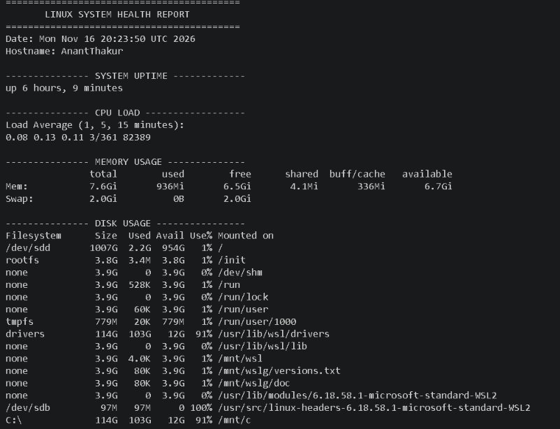
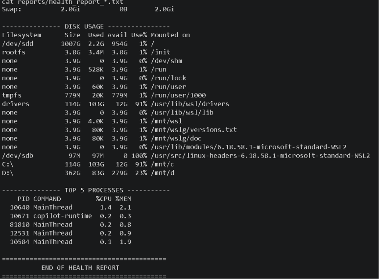
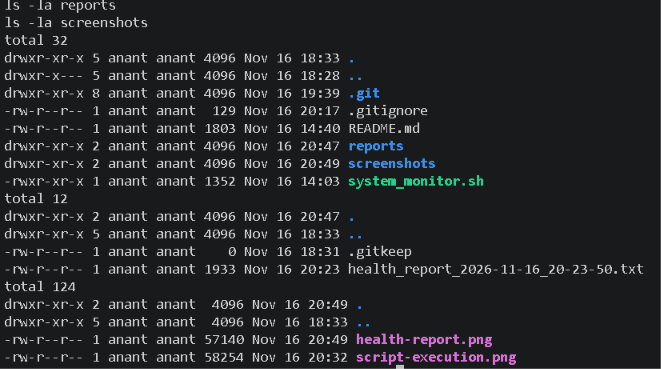

# Linux System Health Monitor

A Bash-based Linux system monitoring tool that collects essential system health information and generates timestamped reports for easy monitoring and analysis.

## Features

- **System Uptime:** Displays how long the system has been running.
- **CPU Load Monitoring:** Displays CPU load averages over 1, 5, and 15 minutes.
- **Memory Monitoring:** Shows total, used, free, and available memory.
- **Disk Usage Monitoring:** Displays filesystem storage utilization.
- **Process Monitoring:** Identifies the top 5 CPU-consuming processes.
- **Automated Reporting:** Generates timestamped system health reports.
- **Organized Storage:** Saves generated reports in the `reports/` directory.

## Technologies Used

- Ubuntu Linux 24.04
- Bash Shell Scripting
- Linux Command-Line Utilities
- Windows Subsystem for Linux (WSL 2)
- Visual Studio Code
- Git and GitHub

## Project Structure

```text
linux-system-health-monitor/
│
├── .gitignore
├── README.md
├── system_monitor.sh
│
├── reports/
│   └── .gitkeep
│
└── screenshots/
```

## Installation and Execution

### 1. Clone the repository

```bash
git clone https://github.com/Anant-Pratap-Singh/linux-system-health-monitor.git
```

### 2. Navigate to the project directory

```bash
cd linux-system-health-monitor
```

### 3. Give execution permission

```bash
chmod +x system_monitor.sh
```

### 4. Execute the script

```bash
./system_monitor.sh
```

### 5. View the generated report

```bash
ls reports/
```

To view a report:

```bash
cat reports/health_report_*.txt
```

## Sample Report Information

The generated report includes:

- Current date and hostname
- System uptime
- CPU load averages
- Memory usage
- Disk usage
- Top 5 CPU-consuming processes

## Learning Outcomes

Through this project, I gained practical experience in:

- Linux command-line operations
- Bash shell scripting
- Linux system resource monitoring
- File and directory management
- Automated report generation
- Version control using Git and GitHub
- Working with Ubuntu through WSL 2

## Future Enhancements

- Email notifications for critical system conditions
- CPU and memory usage threshold alerts
- Automated periodic monitoring
- Graphical system health reports

## Author

**Anant Pratap Singh**

*Linux System Health Monitor – A practical project demonstrating Linux administration and Bash scripting fundamentals.*

## Project Screenshots

### 1. Script Execution


### 2. Generated Health Report


### 3. Project Structure

